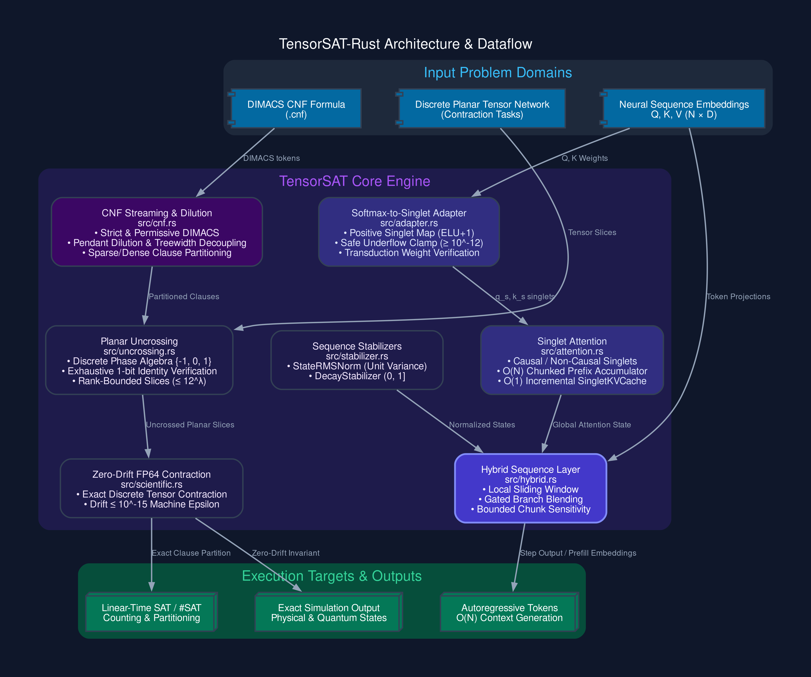
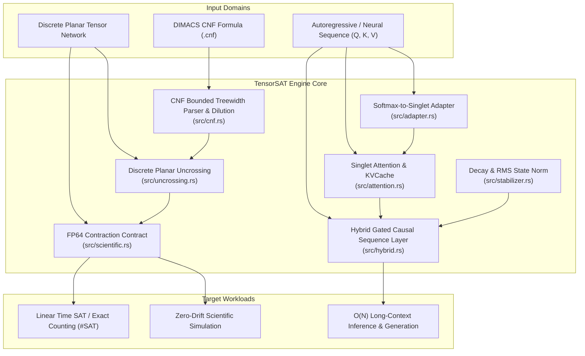
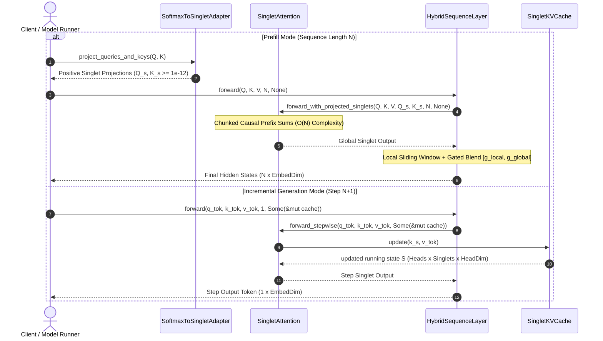
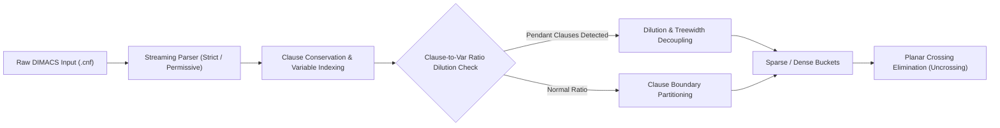
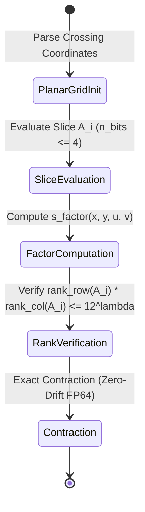
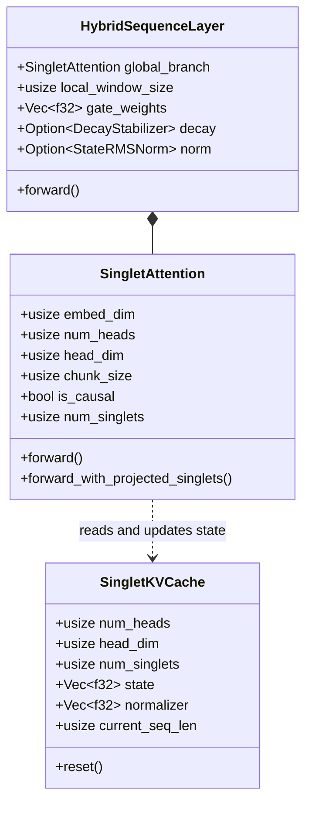
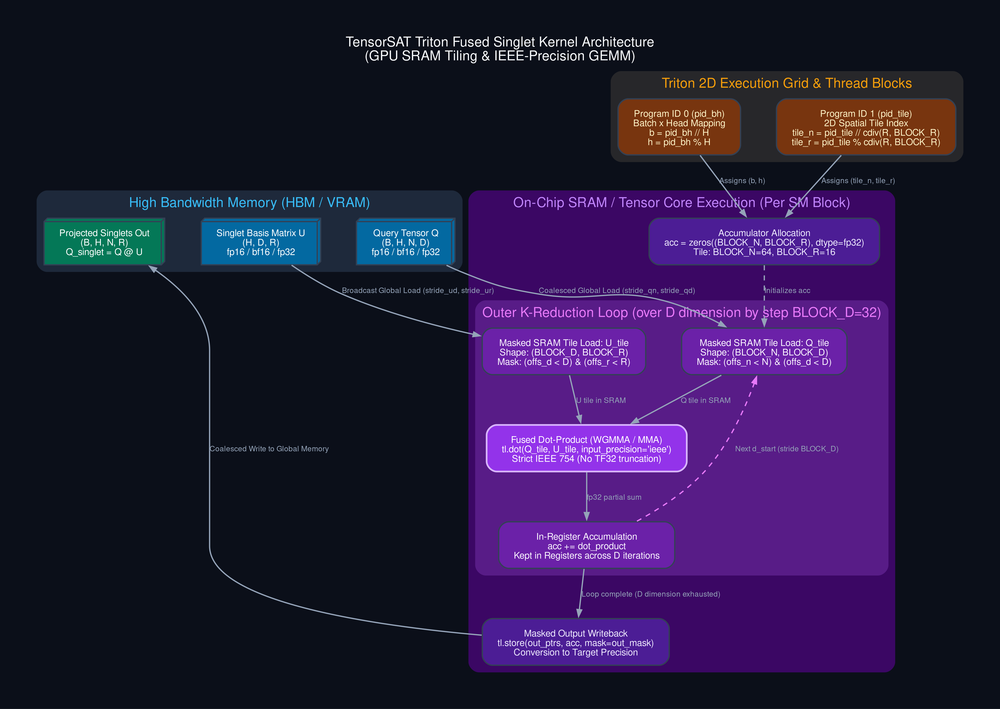

# TensorSAT-Rust Architecture & Pipeline Specification

This document provides architectural diagrams, execution flowcharts, and component pipelines for the **TensorSAT-Rust** engine.

---

## 1. High-Level System Architecture

TensorSAT decomposes SAT formulas, discrete tensor networks, and neural sequence representations into linear-complexity exact or bounded contractions.

---

## 2. Neural Attention & Hybrid Layer Pipeline

The neural sequence execution pipeline supports both full sequence prefill ($\mathcal{O}(N)$ chunked singlet attention) and recurrent incremental decoding ($\mathcal{O}(1)$ step latency via `SingletKVCache`).

---

## 3. CNF Partitioning & Dilution Pipeline

The CNF pre-processor ingests DIMACS formulas and performs topological partitioning:

---

## 4. Discrete Planar Uncrossing Engine

Planar graphs and crossings are reduced via the deterministic $\{-1, 0, 1\}$ tensor algebra:

---

## 5. Memory & Cache Hierarchy for Inference

---

## 6. GPU Acceleration: Triton Fused Singlet Kernel

The low-rank projection $Q_{\text{singlet}} = Q \times U$ ($B \times H \times N \times D \to B \times H \times N \times R$) is accelerated on NVIDIA/AMD GPUs using fused Triton kernels (`triton_singlet_proj`).

### Key Features:
- **2D Tiled Grid Mapping**: Thread blocks are dispatched across a 2D grid `(B * H, num_n_tiles * num_r_tiles)`.
- **SRAM Staging**: Blocks iterate across dimension $D$ in slices of `BLOCK_D = 32`, holding accumulator tiles of size `BLOCK_N = 64` $\times$ `BLOCK_R = 16` directly in on-chip registers.
- **Strict IEEE-Precision GEMM**: Uses `input_precision="ieee"` in `tl.dot` to avoid TF32 truncation artifacts, maintaining exact discrete low-rank properties.
